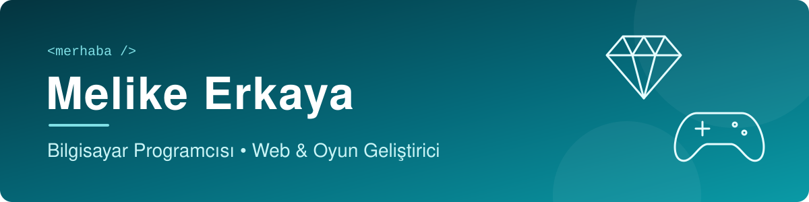

  

  
  
  

## 👋 Hakkımda

Merhaba, ben **Melike**. İstanbul Ticaret Üniversitesi **Bilgisayar Programcılığı** mezunuyum.
Modern, mobil uyumlu ve kullanıcı deneyimi odaklı web siteleri geliştiriyorum. Aynı zamanda **Unity** ile oyun geliştiriyorum.

- 💻 **Web:** React, JavaScript, Node.js ve MongoDB ile projeler üretiyorum
- 🎮 **Oyun:** Unity ve C# ile sahne yönetimi, arayüz, animasyon ve etkileşimli mekanikler üzerinde çalışıyorum
- 🌱 **Gelişim:** C#, React ve Python bilgimi ilerletiyor, SAP ABAP öğreniyorum

## 🛠️ Teknolojiler

  
  
  
  
  
  
  
  
  

**Öğrenmeye devam ettiklerim**

  
  

## 🚀 Projelerim

| Proje | Açıklama | Teknolojiler |
|---|---|---|
| 💎 **Pırlanta E-Ticaret Sitesi** [Canlı site](https://pirlantawebsite-frontend.vercel.app) · [Frontend](https://github.com/melikeerkaya/PirlantaWebSite-Frontend) · [Backend](https://github.com/melikeerkaya/PirlantaWebSite-Backend) | Pırlanta temalı e-ticaret sitesi | HTML, CSS, JavaScript, Node.js, MongoDB |
| 🧙 **Pembe Büyücü** [Tarayıcıda oyna](https://melikeerkaya.github.io/Wizardrunninggame/) · [Kodlar](https://github.com/melikeerkaya/Wizardrunninggame) | Bilgisayarda ve telefonda tarayıcıdan oynanan koşu oyunu | Unity, C# |
| ⚖️ **Savcı Simülasyonu** [Kodlar](https://github.com/melikeerkaya/ProsecutorGame) | Savcılık ofisinde geçen, geliştirdiğim oyun | Unity, C# |
| 🛠️ **Yönetim Paneli** [Kodlar](https://github.com/melikeerkaya/SoftItoBitirmeProjesi) | SoftITo bitirme projem: kullanıcı girişi, API bağlantısı ve ürün yönetimi | React, Bootstrap |
| 📘 **SAP ABAP Çalışmalarım** [Kodlar](https://github.com/melikeerkaya/sap-abap-learning) | Öğrenme sürecim ve uygulama projelerim | ABAP |

## 💼 Deneyim

- **Web Geliştirici (Freelance)**, CE Ajans Web sitelerinin tasarımı, düzenlenmesi ve içerik yönetimi
- **Editör**, İstanboolToday / Gaphaber Zorunlu stajımın ardından web sitesinde editörlük
- **Destek Uzmanı (Stajyer)**, Mikro Max Yazılım Hizmetleri Mikro yazılım çözümlerinde müşteri sorunlarına çözüm bulma

## 🎓 Eğitim

- **Bilgisayar Programcılığı (Ön Lisans)**, İstanbul Ticaret Üniversitesi · 2022 - 2024
- **Frontend Developer Eğitimi**, SoftITo Yazılım-Bilişim Akademisi (İstanbul Ticaret Odası) · Ocak - Nisan 2025

## 🏅 Sertifikalar

- SoftITo Yazılım Akademisi Başarı Sertifikası (2025)
- ERP Başarı Sertifikası (2024)
- BOSS Gen-Code Summit (2024)
- FRC Kickoff (2020)

---

<b>🇬🇧 About me (English)</b>

 

I am a Computer Programming graduate from Istanbul Commerce University. I build modern, responsive, user-focused websites with HTML, CSS, JavaScript, React, Node.js and MongoDB, and I develop games with Unity and C#. I completed the Frontend Developer program at SoftITo Academy in 2025, and I am currently improving my skills and learning SAP ABAP.

